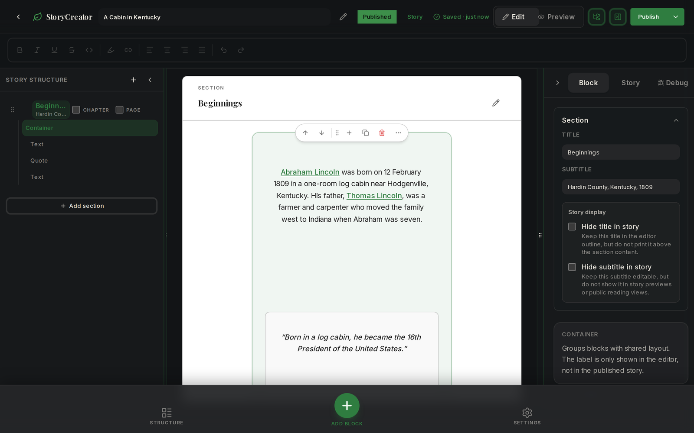
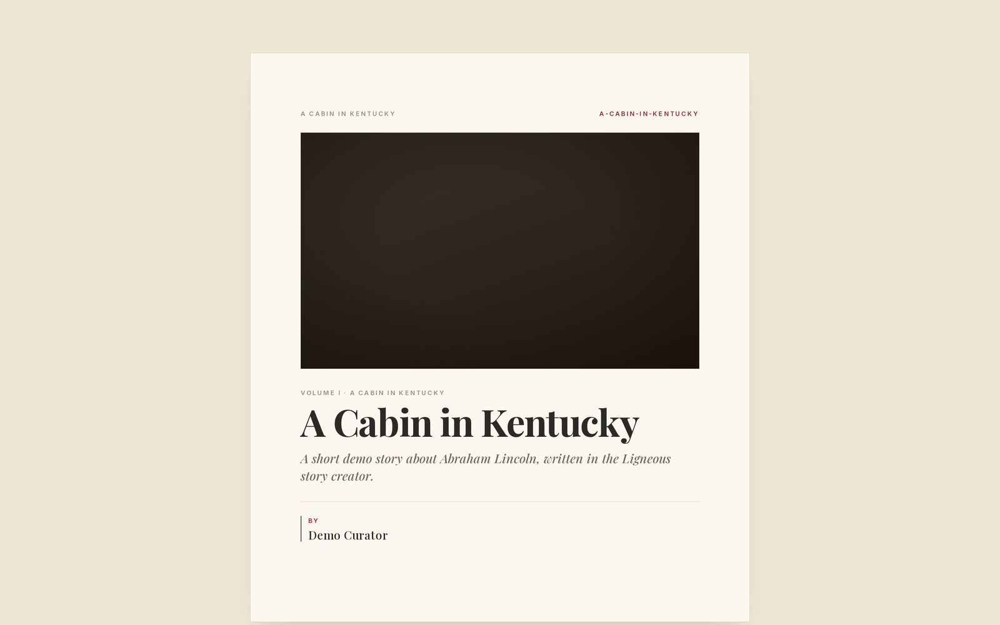
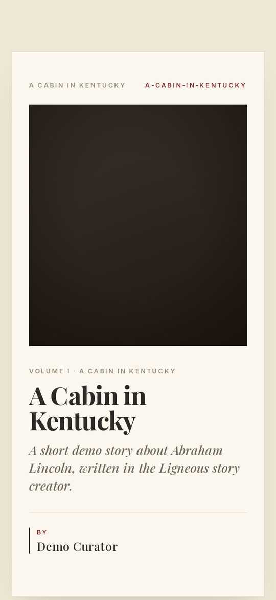

# @ligneous/story-creator

A React block editor for writing family history stories that link to the people, families, events and places in a genealogy tree.

**Architecture:** [docs/ARCHITECTURE.md](docs/ARCHITECTURE.md)

Authors build a story from sections and blocks: rich text, photos, tables, columns, and live embeds such as a timeline of a person's life. Text can link straight to a person's profile. The editor saves a versioned JSON document, and the package includes helpers to map that document to and from Postgres rows.

## Screenshots

These come from the Gonsalves family site and its admin app running on a demo database, loaded with the public US-presidents sample tree (`pres2020.ged`) through the real import pipeline. No family data is shown.



*The editor: section outline, rich text with links to people in the tree, a pull quote, and the inspector.*



*The published story on the public site.*



*The story on a phone.*

## What it does

- **Document model** (`src/types.ts`): a `StoryDocument` has metadata (title, slug, authors, kind, status, cover image, tags) and a tree of `StorySection`s. Sections can nest, can be marked as chapters or pages, and hold an ordered list of blocks.
- **Block types** (`StoryBlock`):
  - `richText`: TipTap content with presets for paragraph, heading, list, verse and quote
  - `media`: an image or other media item with caption and layout
  - `embed`: a live genealogy embed (see below)
  - `columns`: side-by-side slots holding nested blocks
  - `splitContent`: main content with a supporting slot
  - `container`: a styled wrapper (card, callout, hero, quote)
  - `table`
  - `divider`: line, spacer, ornamental or section break
- **Embed kinds**: `timeline`, `personSpotlight`, `familyGroup`, `event`, `gallery`, `document`, `graph`, `recipe`, `map` and `tree`. Media and embeds can also sit inline inside rich text as "flow" nodes. The `map` and `tree` embeds are placeholders for now ("Coming in a later phase").
- **Editor UI**: a structure sidebar, a canvas with edit and preview modes, an inspector panel, a floating toolbar, undo history, and a mobile layout.
- **Persistence helpers**: `storyDocumentToDbPayload` and `dbRecordToStoryDocument` map the document to the Prisma story tables (stories, chapters, sections, linked individuals, families, places). `migrateStoryDocument` upgrades older drafts and `validateStoryDocumentStrictBlocks` checks a document before saving.

### How stories reference people and events

Stories point at tree records by database id, and usually also by GEDCOM xref:

- **Inline links**: a TipTap `Link` mark extended with `entityType`, `entityId` and `entityXref` attributes (`src/editor/story-tiptap-link-extension.ts`). Person links go to `/individuals/:id`.
- **Embed subjects**: each embed can carry a `subject` of type `individual`, `family`, `event`, `place`, `album`, `media`, `tree` or `note`, with `id` and optional `xref`.
- **Timeline rules**: a timeline embed is defined by rules such as "events for this person", "events for this family" or "events of this person's parents and children".
- **Section and story links**: `StorySection.entityLinks` and `StoryDocument.linkedRecords` / `placeLinks` record which people, families, events and places a story discusses.

The package does not query any database for these. The host app injects search pickers, media lookup and timeline data through React context providers.

## Where it fits in Ligneous

Ligneous is a genealogy platform. A Go library parses GEDCOM files; the data lives in Postgres and is read through Prisma by Next.js apps.

Used by:

- `the-gonsalves-family-admin` (private): the story editor in the admin app (`src/components/admin/story-creator/`).
- `ligneous-frontend` (private): the story editor and the story API routes (`components/stories/`, `lib/stories/persist-story-from-document.js`).

### Data it consumes

Its own `StoryDocument` JSON, which it defines. Entity references are Prisma record ids (UUIDs) plus GEDCOM xrefs from the Postgres tables. The package does not read the Go parser's intermediate representation. `src/utils/story-db-mapping.ts` imports types from `@ligneous/prisma`.

## Entry points

| Import | Contents | Pulls in TipTap? |
| --- | --- | --- |
| `@ligneous/story-creator` | Types, block factories, document mutators, migration, validation, DB mapping, TipTap extensions | Yes, for the extensions |
| `@ligneous/story-creator/editor` | `StoryCreatorClient`, context providers, editor store | Yes |
| `@ligneous/story-creator/renderer` | Public read-only renderer | Not yet: this entry point is an empty placeholder |

## Install

The package is not published to npm (`"private": true`). It ships TypeScript source, so your bundler compiles it (in Next.js, add it to `transpilePackages`).

```json
{
  "dependencies": {
    "@ligneous/story-creator": "file:../ligneous-story-creator"
  }
}
```

Peer dependencies: `react` and `react-dom` 19, `@base-ui/react`, `@headlessui/react`, `sonner`, and `@ligneous/timeline-view` (used by the timeline embed). `@ligneous/timeline-view` and `@ligneous/prisma` are private packages, so a fresh clone cannot build on its own. The styles use Tailwind and daisyUI-style class names (`bg-base-100`), so the host app needs a matching Tailwind setup.

## Usage

Mount the editor and give it load and save callbacks. Wrap it in the providers for the pickers you support; any picker you leave out is turned off.

```tsx
"use client";

import {
  StoryCreatorClient,
  StoryEditorPickersProvider,
} from "@ligneous/story-creator/editor";
import type { StoryDocument } from "@ligneous/story-creator";

export function StoryEditorPage({ storyId }: { storyId: string }) {
  return (
    <StoryEditorPickersProvider IndividualSearchPicker={MyPersonPicker}>
      <StoryCreatorClient
        storyId={storyId}
        onLoad={async (id) => (await fetch(`/api/stories/${id}`)).json()}
        onSave={async (doc: StoryDocument) =>
          (await fetch(`/api/stories/${doc.id}`, {
            method: "PUT",
            body: JSON.stringify(doc),
          })).json()
        }
      />
    </StoryEditorPickersProvider>
  );
}
```

`MyPersonPicker` and the `/api/stories` routes belong to your app. For a full wiring, see `src/components/admin/story-creator/StoryCreatorClient.tsx` in the admin app, which also uses `StoryEditorMediaProvider` and `StoryEditorTimelineProvider`.

Work with documents without the UI:

```ts
import {
  createRichTextBlock,
  createEmbedBlock,
  migrateStoryDocument,
  validateStoryDocumentStrictBlocks,
} from "@ligneous/story-creator";

const intro = createRichTextBlock();
const timeline = createEmbedBlock("timeline");
const upgraded = migrateStoryDocument(oldDraft);
const result = validateStoryDocumentStrictBlocks(upgraded);
```

## Test

`package.json` has no scripts. Tests use Vitest (`vitest.config.ts`, files in `test/` and `src/**/*.test.ts`). After installing dependencies:

```sh
npx vitest run
```

The suites cover block factories, block moves, column layout, document mutators, embed checks, the section tree, TipTap document helpers and editor store actions. A Storybook config exists in `.storybook/`, but there are no stories yet.

## Stack

React 19, TypeScript, TipTap 3 (StarterKit, Link, Table, Highlight, Text Align, Text Style, Placeholder, Underline, plus custom nodes), Zustand for editor state, Tailwind classes via `clsx` and `tailwind-merge`, DOMPurify for caption HTML, Lucide icons, Vitest.

## Related repos

- [Ligneous](https://github.com/lesfleursdelanuitdev/Ligneous): project overview
- [ligneous-gedcom-lib](https://github.com/lesfleursdelanuitdev/ligneous-gedcom-lib): Go GEDCOM parser
- `the-gonsalves-family-admin` (private) and `ligneous-frontend` (private): apps that use this editor

## License

No license file: all rights reserved.

Part of Ligneous: https://github.com/lesfleursdelanuitdev/Ligneous
