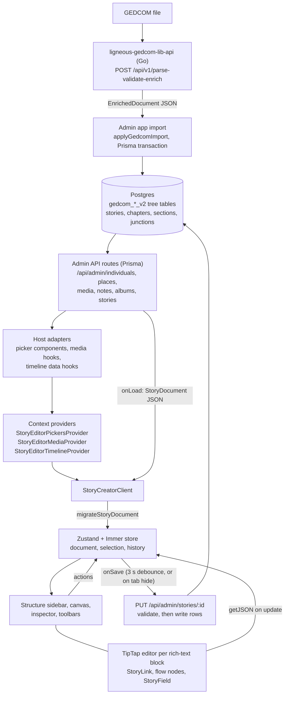

# Architecture: @ligneous/story-creator

## Summary

`@ligneous/story-creator` is a React block editor for family history stories. A story is one versioned JSON document (`StoryDocument`): metadata plus a tree of sections, each holding an ordered list of typed blocks. Rich-text blocks store TipTap JSON. Other blocks hold media, live genealogy embeds, columns, tables and styled containers. Text and embeds point at people, families, events and places by database id and GEDCOM xref. The editor keeps the document in a Zustand store with Immer and undo history, and hands it to the host app's `onSave` callback. The package never calls a database or API itself. The host app supplies loading and saving, search pickers, media lookup and timeline data through React context. The package also ships pure helpers to create, move, migrate, validate and serialise documents.

## Data flow



The tree data comes from GEDCOM. The admin app (the-gonsalves-family-admin, private) sends each uploaded file to [ligneous-gedcom-lib-api](https://github.com/lesfleursdelanuitdev/ligneous-gedcom-lib-api), which runs the [ligneous-gedcom-lib](https://github.com/lesfleursdelanuitdev/ligneous-gedcom-lib) parser and enricher and returns an `EnrichedDocument`. The admin app writes that into the `gedcom_*_v2` tables through the shared Prisma client (ligneous-prisma, private). The editor reaches tree records only through the admin app's picker components and hooks, which call the admin API routes. Stories themselves live in separate Prisma tables (`stories`, chapters, sections and junctions to individuals, families, events, places and albums). The public site (the-gonsalves-family, private) reads them with its own story reader code.

## Modules

| Path | Responsibility |
| --- | --- |
| `src/types.ts` | The document model: `StoryDocument`, `StorySection`, the `StoryBlock` union, embed data types, timeline rules |
| `src/index.ts` | Root entry: types and pure utilities, plus the TipTap document helpers and custom nodes in `src/tiptap/` |
| `src/utils/story-block-factory.ts` | `createRichTextBlock`, `createEmbedBlock` and other block constructors |
| `src/utils/story-doc-mutators.ts`, `story-section-tree.ts`, `story-block-move-relative.ts`, `story-columns-*.ts` | Pure tree edits: find, insert, move, delete blocks and sections; column depth rules |
| `src/utils/migrate-story-document.ts` | Upgrades older drafts to the current shape |
| `src/utils/story-document-strict-validate.ts` | `validateStoryDocumentStrictBlocks`: checks block types allowed in each slot and embed kinds |
| `src/utils/story-db-mapping.ts` | `storyDocumentToDbPayload`, `dbRecordToStoryDocument`, `STORY_DB_READ_INCLUDE` for Prisma |
| `src/editor/index.ts` | Editor entry: `StoryCreatorClient`, context providers, store provider and hook |
| `src/editor/StoryCreatorClient.tsx` | Editor shell: load, migrate, autosave, publish, panel layout, desktop and mobile |
| `src/editor/state/` | Zustand store (`storyEditorStore.ts`), actions, selectors, history snapshots |
| `src/editor/StoryTipTapEditor.tsx`, `story-tiptap-extensions.ts` | One TipTap instance per rich-text block and its extension list |
| `src/editor/story-tiptap-link-extension.ts` | `StoryLink`: the Link mark with entity attributes |
| `src/editor/story-tiptap-flow-extensions.tsx` | Inline media and embed nodes inside rich text |
| `src/editor/embeds/` | Canvas views for each embed kind |
| `src/editor/inspector/` | Inspector panels for story settings, blocks, flow nodes and timeline embeds |
| `src/editor/pickers-context.tsx`, `media-context.tsx`, `timeline-embed-context.tsx` | Injection points for host-app data |
| `src/renderer/index.ts` | Planned public renderer entry; currently exports nothing |

## Document model

```
StoryDocument (version: 1)
  metadata: title, slug, authors[], kind, status, cover/profile image, tags,
            linkedRecords[], placeLinks[], linkedAlbums[]
  sections: StorySection[]
    StorySection: title, subtitle, isChapter, isPage, entityLinks[]
      blocks: StoryBlock[]
      children: StorySection[]      (nesting)
```

`StoryBlock` is a tagged union of eight types: `richText`, `media`, `embed`, `columns`, `splitContent`, `container`, `table` and `divider`. A `columns` block has exactly two slots, each with its own block list. Columns can nest one level (`MAX_STORY_COLUMNS_NEST_DEPTH = 2`). Embed blocks name a kind (`timeline`, `personSpotlight`, `familyGroup`, `event`, `gallery`, `document`, `graph`, `recipe`, `map`, `tree`) and an optional `subject` of type `individual`, `family`, `event`, `place`, `album`, `media`, `tree` or `note`, with `id` and `xref`.

## Editor internals

**Store.** `createStoryEditorStore` builds a vanilla Zustand store with Immer middleware. `StoryEditorStoreProvider` creates one store per editor instance and keeps it in a ref, so two editors on a page do not share state. The store holds the document, the selected section, block and flow node, the active TipTap editor, panel state, edit or preview mode, `dirty`, and the history. Structural actions (add, delete, duplicate, move blocks and sections) push a snapshot first. Block content updates schedule one snapshot 500 ms after the last change, so typing makes one undo step. History keeps 100 past snapshots. Snapshots are deep copies made with a JSON round trip, because Immer drafts are proxies that `structuredClone` rejects.

**TipTap.** Each rich-text block mounts its own TipTap editor. `onUpdate` writes `editor.getJSON()` back to the block in the store. The extension list is StarterKit (headings 1 to 6, the built-in link turned off), `StoryLink`, Highlight, Placeholder, TextStyle with FontSize, TextAlign, the table kit and three custom nodes:

- `storyFlowMedia` and `storyFlowEmbed`: media items and embeds placed inline in the text, with display mode (`block` or `wrapped`), alignment and size.
- `storyField`: an inline chip that shows the story's title, subtitle or author.

Preview mode renders the same JSON to HTML with TipTap's `generateHTML`. Caption HTML passes through DOMPurify.

**Entity links.** `StoryLink` extends TipTap's Link mark with `entityType`, `entityId` and `entityXref`, stored as `data-entity-*` attributes. The toolbar buttons insert links for a person (`/individuals/:id`), family (`/families/:id`), event (`/tree/events/:id`) or place (`/tree/places/:id`), chosen through the host's pickers. At section level, `StorySection.entityLinks` lists what the section discusses. At story level, `linkedRecords` and `placeLinks` do the same. Timeline embeds select events by rules (`personEvents`, `familyEvents`, `memberEvents`, `noteEvents`, `relativeEvents` with parents, siblings, children or grandchildren) plus year and type filters. The timeline itself is drawn by `@ligneous/timeline-view` (private).

**Load and save.** `StoryCreatorClient` calls `onLoad(storyId)` and runs `migrateStoryDocument`. If migration changed the document, it saves the result at once and shows a toast. Edits set `dirty`, and an autosave runs 3 seconds after the last change. The client also saves when the tab is hidden. "Publish" calls `onPublish` if the host passed one, or saves with `status: "published"`.

**Database mapping.** `storyDocumentToDbPayload` turns each top-level section into a chapter row. If the section has children, each child becomes a section row; if not, the section itself becomes the only section row. Each section row stores its blocks as `content_json: { blocks }`. Linked records become junction id lists, and author credits are serialised into the story `body`. `dbRecordToStoryDocument` reverses this.

## Renderer status

The `./renderer` export exists in `package.json`, but `src/renderer/index.ts` is an empty module (`export {}`). Its comment describes the plan: a public renderer with no TipTap dependency, with embed data supplied by resolvers from the host app. Today the only rendering in the package is the editor's preview mode. The public site has its own reader.

## Design decisions

| Choice | Cost | Why |
| --- | --- | --- |
| One JSON document per story, edited as a whole | Every save sends the whole document, and the package does no conflict check, so two people editing one story overwrite each other | Simple undo, migration and validation; the editor state is just the document |
| Host data injected through context providers | Each host app writes picker and media adapters | The package has no API routes, auth or database code, so two apps can use it |
| Separate entry points (root, `editor`, `renderer`) | Three export paths to keep apart | Server code can import types and helpers without loading the editor UI |
| One TipTap instance per rich-text block | Many editors on a long story | Blocks can be moved, styled and laid out in columns independently |
| Entity links as attributes on the standard Link mark | Plain `<a>` tags carry the data, so other renderers must read `data-entity-*` | An entity link is still an ordinary link in TipTap's HTML output and in preview |
| `migrateStoryDocument` on every load | Upgrade code grows with each format change | Old drafts keep opening; no separate migration job |
| Zustand vanilla store with Immer | Proxy drafts need care when cloning | Mutations read as plain assignments, and selectors limit re-renders |

## Testing

There are 9 Vitest files with 127 `it`/`test` cases (counted in source, not run here): 8 files in `test/` and `src/editor/state/storyEditorActions.test.ts`. They cover block factories (18), the section tree (28), document mutators (23), store actions (16), column layout (14), shared utilities (13), block moves (7), embed checks (6) and TipTap document helpers (2). The environment is `node`, so no React component is rendered in tests. `package.json` has no `scripts`; run `npx vitest run` after installing. A Storybook config exists in `.storybook/`, but there are no stories.

## Known limitations

- **Empty renderer entry.** `@ligneous/story-creator/renderer` exports nothing yet.
- **Missing dependencies in `package.json`.** The source imports `@tiptap/react`, `@tiptap/starter-kit`, `@tiptap/extension-link`, `@tiptap/extension-highlight`, `@tiptap/extension-placeholder`, `@tiptap/extension-text-align`, `@tiptap/extension-text-style`, `@tiptap/extension-underline`, `lucide-react` and `@ligneous/prisma`, none of which are declared. It builds today only because the host apps install them.
- **Private dependencies.** `@ligneous/prisma` and `@ligneous/timeline-view` are private, so a fresh clone cannot type-check or build on its own.
- **Copies in the admin app.** The admin app uses the package's editor UI, but keeps its own copies of the types, DB mapping, validation and migration under `lib/admin/story-creator/`. The copies have drifted: the admin mapping saves `StorySection.entityLinks` inside `content_json`, and the package mapping does not.
- **Two-level storage.** The DB mapping keeps top-level sections and their direct children. A top-level section's own blocks are dropped when it has children, and deeper nesting is not stored, although the editor's type allows both.
- **Placeholder embeds.** The `map` and `tree` embeds show "Coming in a later phase".
- **Duplicate file.** `src/editor/story-tiptap-doc.ts` and `src/tiptap/story-tiptap-doc.ts` are two slightly different copies of the same helper.
